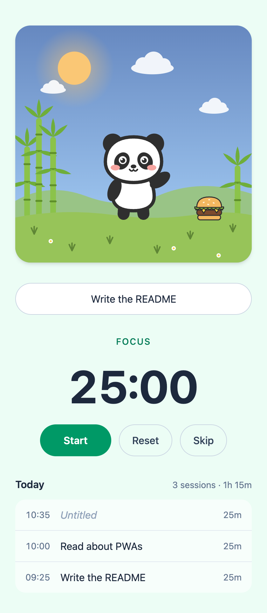
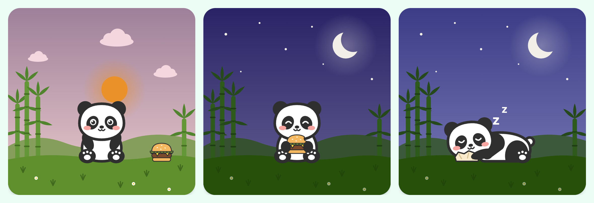

# 🐼 Panda Pomodoro

A Pomodoro timer with a panda who loves cheeseburgers. Built for two people to
focus together, one phase at a time.

**Live demo: [pomodoro-app-bay-nine.vercel.app](https://pomodoro-app-bay-nine.vercel.app/)**

<p align="center">
  
</p>

## The story

The whole timer is one scene, driven by how much time is left.

<p align="center">
  
</p>

1. **Focus:** the sun sets while you work. The panda gets tired, and the cheeseburger waits on the grass.
2. **Break, first half:** you earned it. The panda eats the burger.
3. **Break, second half:** the panda falls asleep, hugging the empty wrapper.

## Features

- 25 minute focus and 5 minute break, with start, pause, reset, and skip
- When time is up, the next mode waits for you, so a break never runs out unseen
- A soft chime when a timer ends: down for "relax", up for "back to work"
- The browser tab shows the time left, so you can check it from another tab
- Name what you are working on; finished focus sessions are listed under "Today"
- History is saved in the browser and survives a reload
- Respects "reduce motion": the scene still changes, but nothing bounces or drifts

## Tech stack

| Tool | Why |
|---|---|
| React 19 + TypeScript | Components for the UI; types catch mistakes before the browser does |
| Vite | Fast dev server with instant reload, and a small production build |
| Tailwind CSS v4 | Styles next to the markup; custom animations are defined in one `@theme` block |
| Vitest | Same config as Vite, so tests run in milliseconds |
| oxlint | A fast linter. It caught a real bug (see below) |
| Vercel | Free hosting; every push to `main` deploys |

No image or sound files: the scene is hand-written SVG, and the chime is
synthesized with the Web Audio API.

## Design decisions

**The timer is pure functions.** `timer.ts` holds no clock of its own. Each
function takes the state and `now` and returns a new state, so tests pass in a
fixed time instead of waiting 25 minutes. A React hook (`useTimer`) is the only
place that reads the real clock.

**Two clocks, two jobs.** An interval refreshes the screen every few hundred
milliseconds. A separate one-off timeout fires exactly when the time is up and
plays the chime. The countdown is always computed from the end time, so a slow
or sleeping tab never makes the timer drift.

**The scene has no state of its own.** `PandaScene` only gets `mode`, `status`,
and `progress` (0 to 1). The sky color, the sun's position, and the panda's pose
are all pure functions of those, so the picture can never disagree with the
timer.

**Saved data is treated as untrusted.** History is stored in `localStorage`
under a versioned key (`panda-pomodoro:sessions:v1`). On load, every entry is
checked with a type guard, and broken data is ignored instead of crashing the
app. Storage is passed in as a parameter, so tests use a fake one.

**The linter found a bug.** oxlint flagged `Date.now()` being called while
rendering. Fixing it properly (reading the time from the timer hook) showed
that a session that had just finished was missing from "Today": the list was
filtered with an out-of-date time. Both are fixed.

The full design, including the plans for accounts and two-person rooms, is in
[docs/design.md](docs/design.md).

## Run it locally

You need Node.js 20.19+ or 22.12+ (required by Vite 8).

```bash
npm install
npm run dev       # http://localhost:5173
npm test          # Vitest in watch mode
npm run lint      # oxlint
npm run build     # type-check and build to dist/
```

In development, a "Scene preview" panel lets you move through every scene
without waiting for the timer.

## Project structure

```
src/
├── timer/      Timer logic (pure functions), useTimer hook, tab title
├── scene/      The SVG scene: sky, panda, cheeseburger, bamboo
├── history/    Focus sessions, localStorage, useSessions hook
├── sound/      The Web Audio chime
└── components/ Task input, timer controls, today's history
```

Tests sit next to the code they test (`*.test.ts`).

## Roadmap

- [x] **Phase 1:** solo timer, panda scene, sound, task names, history, deploy to Vercel
- [ ] **Phase 2:** installable PWA: works offline, notifications
- [ ] **Phase 3:** Express API, PostgreSQL (Neon), accounts, stats
- [ ] **Phase 4:** Docker, Google Cloud Run, CI/CD
- [ ] **Phase 5:** duo mode: two pandas, one shared timer over WebSocket
