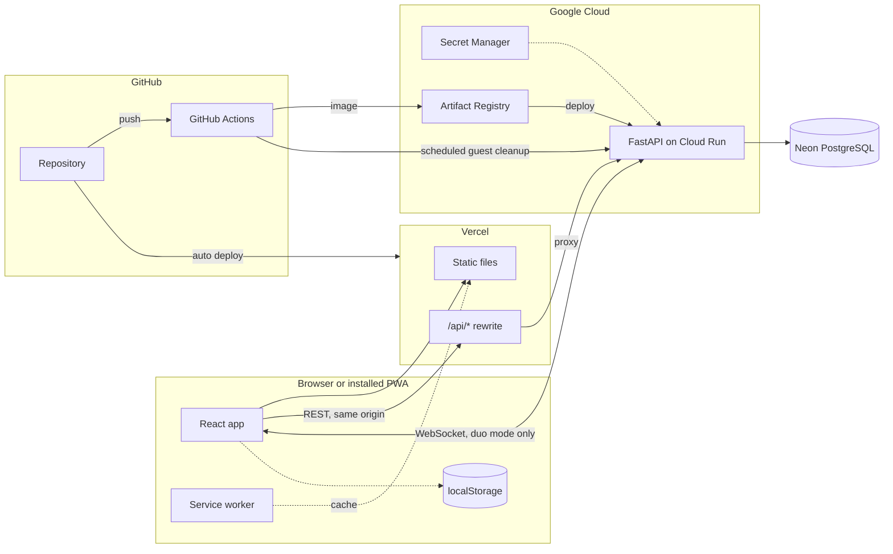
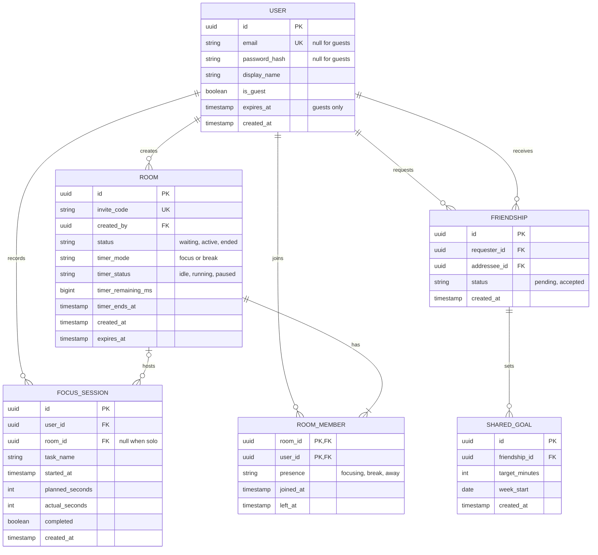
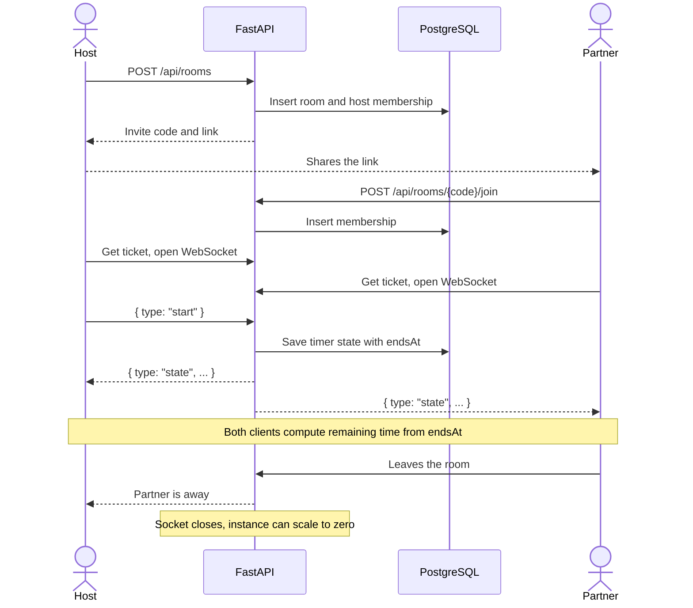

# pomodoro-app — Design

A focus app for two. Each person can run a Pomodoro timer alone, or invite a
partner so both timers count down together. The UI is a single scene: a panda
in a field. During focus the sun sets and the panda slowly lies down; during
the break the moon comes out and the panda sleeps.

> Status: living document. Items marked **(proposed)** are decided in the
> phase noted next to them.

## Contents

1. [Tools](#1-tools)
2. [Functional requirements](#2-functional-requirements)
3. [Non-functional requirements](#3-non-functional-requirements)
4. [System architecture](#4-system-architecture)
5. [Data model (ERD)](#5-data-model-erd)
6. [API](#6-api)
7. [Duo mode flow](#7-duo-mode-flow)
8. [Key design decisions](#8-key-design-decisions)
9. [Open decisions](#9-open-decisions)

---

## 1. Tools

| Phase | Tool | Purpose |
|---|---|---|
| 1 | Node.js + npm | Run the frontend toolchain and manage packages |
| 1 | TypeScript | Type-safe JavaScript for the frontend |
| 1 | React | UI components |
| 1 | Vite | Dev server with hot reload, production bundler |
| 1 | Tailwind CSS v4 | Utility-first styling |
| 1 | SVG + CSS transitions | The panda day/night scene and its animations |
| 1 | Vitest | Unit tests for timer logic and components |
| 1 | oxlint | Fast linter for TypeScript and React |
| 1 | localStorage | Save tasks and history in the browser (phase 1 only) |
| 1 | Git + GitHub | Version control and public repository |
| 1 | Vercel (Hobby) | Host the frontend, auto-deploy on every push |
| 2 | vite-plugin-pwa (Workbox) | Generate the web app manifest and service worker |
| 2 | Service worker | Offline support and asset caching |
| 2 | Notifications API | Desktop and phone notification when a timer ends |
| 3 | Python + uv | Backend language and package/project manager |
| 3 | FastAPI **(proposed)** | REST API and WebSocket server |
| 3 | Pydantic | Request and response validation |
| 3 | SQLAlchemy | ORM for PostgreSQL |
| 3 | Alembic | Database migrations |
| 3 | PostgreSQL on Neon | Managed database, free tier |
| 3 | Argon2 password hashing | Store passwords safely |
| 3 | pytest | Backend tests |
| 3 | Ruff | Python linter and formatter |
| 4 | Docker | Package the backend as a container image |
| 4 | Google Cloud Run | Run the backend container, scales to zero |
| 4 | Artifact Registry | Store backend container images |
| 4 | Secret Manager | Store database URL and signing keys |
| 4 | GitHub Actions | CI (lint, test, build) and CD (deploy to Cloud Run) |
| 4 | Rate limiting middleware | Protect public endpoints from abuse |
| 4 | Scheduled job | Delete expired guest accounts |
| 5 | WebSocket | Real-time timer sync during duo sessions only |
| 6 | Playwright | End-to-end browser tests, including two-tab duo mode |
| 6 | Terraform | Infrastructure as code for Cloud Run and related resources |
| 6 | Sentry | Error tracking for frontend and backend |

## 2. Functional requirements

### Timer (phase 1)

| ID | Requirement |
|---|---|
| FR-1 | A user can start, pause, resume, and reset a timer. |
| FR-2 | Focus lasts 25 minutes and a break lasts 5 minutes. |
| FR-3 | When a focus ends, the next mode is a break, and vice versa. |
| FR-4 | A sound plays when a timer ends. |
| FR-5 | The browser tab title shows the remaining time and mode. |
| FR-6 | A user can enter a task name for the current focus. |
| FR-7 | Completed focus sessions are saved and survive a page reload. |

### Panda scene (phase 1)

| ID | Requirement |
|---|---|
| FR-8 | During focus, the sky goes from day to dusk and the sun sets as time passes. |
| FR-9 | During focus, the panda goes from standing to sitting to lying down. |
| FR-10 | During a break, it is night, the moon is out, and the panda sleeps. |
| FR-11 | When paused, the scene freezes and shows a paused indicator. |

### Installable app (phase 2)

| ID | Requirement |
|---|---|
| FR-12 | The app can be installed on desktop and mobile. |
| FR-13 | The solo timer works offline. |
| FR-14 | A notification appears when a timer ends, if the user allowed it. |

### Accounts and stats (phase 3)

| ID | Requirement |
|---|---|
| FR-15 | A user can sign up, log in, and log out. |
| FR-16 | Focus sessions are saved to the user's account. |
| FR-17 | A user can see their stats: focus time per day and per week, and completed sessions. |
| FR-18 | A user only sees their own data. |

### Guest trial (phase 4)

| ID | Requirement |
|---|---|
| FR-19 | A visitor can try the app with one click, without signing up. |
| FR-20 | A guest account comes with demo data. |
| FR-21 | Guest accounts and their data are deleted automatically after 3 days. |
| FR-22 | Guests see a hint: open a second tab to try duo mode. |
| FR-23 | Guests cannot invite or join real accounts. |

### Duo mode (phase 5)

| ID | Requirement |
|---|---|
| FR-24 | A user can create a room and get an invite link and code. |
| FR-25 | Another user can join the room with the link or code. |
| FR-26 | Both members see the same countdown, in sync. |
| FR-27 | Either member can start, pause, or reset the shared timer. |
| FR-28 | Each member sees the other's status: focusing, on a break, or away. |
| FR-29 | The scene shows two pandas, one for each member. |
| FR-30 | The real-time connection opens only while in a room and closes when the user leaves. |

### Extras (phase 6)

| ID | Requirement |
|---|---|
| FR-31 | Users can add each other as friends. |
| FR-32 | Friends can set a shared weekly goal, for example 20 focus hours. |

## 3. Non-functional requirements

| Area | Requirement |
|---|---|
| Cost | Cloud cost targets $0 per month, a few dollars at most. Billing alerts are set on every platform. |
| Cost | The backend scales to zero when idle, with a capped maximum instance count. |
| Cost | WebSocket connections exist only during duo sessions. |
| Timer accuracy | The countdown stays within 1 second of real time, even in a background tab. It is computed from an end timestamp, not by counting ticks. |
| Performance | The frontend loads fast on mobile. The solo timer never waits for the backend. |
| Availability | Backend cold starts are expected. The UI shows a loading state instead of failing. |
| Offline | The solo timer works without a network connection once installed. |
| Security | No secrets in the repository. Configuration comes from environment variables and Secret Manager. An `.env.example` documents them. |
| Security | Passwords are hashed with Argon2. Auth tokens are not readable by JavaScript. |
| Security | Every query is scoped to the current user. Room state is visible to room members only. |
| Security | Public endpoints are rate limited, with stricter limits on login, sign-up, and guest creation. |
| Privacy | Guest data is deleted after 3 days. Only the data the app needs is stored. |
| Accessibility | All controls work with a keyboard and have labels. Animations respect `prefers-reduced-motion`. Text meets WCAG AA contrast. |
| Responsiveness | The layout works from a 360 px wide phone up to a desktop. |
| Maintainability | Timer logic is pure and unit tested. CI runs lint and tests on every push. |
| Language | All UI text, code, and documentation are in English. |

## 4. System architecture

How it fits together:

- **Phases 1–2** use only the left side: the React app, the service worker,
  and localStorage, hosted on Vercel.
- **REST calls** go to `/api/*` on the same domain as the frontend. Vercel
  forwards them to Cloud Run. Because the browser sees one origin, the auth
  cookie is a first-party cookie and CORS is not needed.
- **WebSocket** connects straight to Cloud Run, because Vercel rewrites are
  not expected to proxy WebSocket traffic (to be verified in phase 5).
  The client first gets a short-lived ticket over REST, then uses it to open
  the socket.
- **Guest cleanup** runs on a schedule and deletes expired guests.

## 5. Data model (ERD)

Notes:

- **Guests are regular users** with `is_guest = true` and an `expires_at`.
  Cleanup deletes expired guests, and their sessions are deleted with them
  (`ON DELETE CASCADE`).
- **The room timer columns mirror `TimerState`** from
  `src/timer/timer.ts`. The server stores the end timestamp, so a member who
  reconnects gets the correct remaining time, and any backend instance can
  read the current state.
- **Phase 1 stores focus sessions in localStorage** with the same fields as
  `FOCUS_SESSION`, so moving them to the backend in phase 3 is simple.
- `FRIENDSHIP` and `SHARED_GOAL` are phase 6.

## 6. API

All REST endpoints are under `/api`. Everything except sign-up, login, and
guest creation requires a logged-in user.

| Method | Path | Purpose | Phase |
|---|---|---|---|
| POST | `/api/auth/signup` | Create an account | 3 |
| POST | `/api/auth/login` | Log in, set the auth cookie | 3 |
| POST | `/api/auth/logout` | Clear the auth cookie | 3 |
| GET | `/api/auth/me` | Current user | 3 |
| POST | `/api/auth/guest` | Create a guest account with demo data | 4 |
| GET | `/api/sessions` | List my focus sessions | 3 |
| POST | `/api/sessions` | Save a focus session | 3 |
| GET | `/api/stats?range=week` | My focus totals | 3 |
| POST | `/api/rooms` | Create a room, returns an invite code | 5 |
| POST | `/api/rooms/{code}/join` | Join a room | 5 |
| GET | `/api/rooms/{code}` | Room details and members (members only) | 5 |
| POST | `/api/rooms/{code}/ws-ticket` | Short-lived ticket to open the WebSocket | 5 |
| WS | `/ws/rooms/{code}?ticket=…` | Real-time timer sync | 5 |
| POST | `/api/internal/cleanup-guests` | Delete expired guests (scheduler only) | 4 |
| GET | `/api/health` | Health check | 3 |

WebSocket messages (JSON):

| Direction | Type | Payload |
|---|---|---|
| Client → server | `start`, `pause`, `reset`, `skip` | none |
| Client → server | `presence` | `focusing`, `break`, or `away` |
| Server → client | `state` | Full room timer state and member list |

The server is the source of truth. Clients send intents, the server applies
them with the same pure timer functions, saves the result, and broadcasts the
new state to every member.

## 7. Duo mode flow

## 8. Key design decisions

| Decision | Why |
|---|---|
| Timer stores an end timestamp, not a per-second countdown | Browsers throttle timers in background tabs. Computing `endsAt - now` stays accurate. |
| Timer logic is pure functions with `now` passed in | Easy to unit test without waiting or faking clocks. The same logic can drive the UI, and later the server. |
| Scene is driven by `progress` (0 to 1) and `status` only | The animation has no state of its own, so it can never drift from the timer. |
| Panda poses are discrete (stand, sit, lie) with smooth transitions | Continuous shape morphing is much harder and often looks odd. The sky and sun change continuously. |
| WebSocket only in duo mode | Keeps Cloud Run idle, and free, the rest of the time. |
| REST goes through a Vercel rewrite | Same-origin requests keep the auth cookie first-party, which avoids third-party cookie blocking in Safari and removes the need for CORS. |
| Room timer state lives in the database | A reconnecting member gets the right time, and it works with more than one backend instance. |
| Guests are normal users with an expiry | One code path for both, and cleanup is a single delete. |

## 9. Open decisions

| Topic | Options | Decide in |
|---|---|---|
| Backend language | FastAPI (preferred) or Node.js with Hono | Phase 3 |
| Auth token | Signed session cookie or JWT in an httpOnly cookie | Phase 3 |
| Guest cleanup trigger | GitHub Actions scheduled workflow or Google Cloud Scheduler | Phase 4 |
| Multi-instance WebSocket broadcast | Cap duo traffic at one instance, Cloud Run session affinity, or PostgreSQL `LISTEN/NOTIFY` (check Neon support) | Phase 5 |
| Cloud Run sizing and limits | Check current official docs and pricing before deploying | Phase 4 |
