# pomodoro-app — Design

A focus app for two. Each person can run a Pomodoro timer alone, or invite a
partner so both timers count down together. The UI is a single scene: a panda
in a field who loves cheeseburgers. During focus the sun sets, the panda slowly
lies down, and a cheeseburger waits on the grass. During the break the moon
comes out: the panda eats the burger, then falls asleep hugging the wrapper.

> Status: living document, last updated 2026-11-27. Items marked
> **(proposed)** are decided in the phase noted next to them.

## Contents

**Part 1 — What we are building**

1. [Goals and non-goals](#1-goals-and-non-goals)
2. [Constraints](#2-constraints)
3. [Functional requirements](#3-functional-requirements)
4. [Non-functional requirements](#4-non-functional-requirements)
5. [Capacity estimation](#5-capacity-estimation)

**Part 2 — How it works**

6. [Tech stack](#6-tech-stack)
7. [System context](#7-system-context)
8. [Architecture and deployment](#8-architecture-and-deployment)
9. [Component design](#9-component-design)
10. [Data model](#10-data-model)
11. [API](#11-api)
12. [Key flows](#12-key-flows)

**Part 3 — Keeping it safe, running, and cheap**

13. [Security](#13-security)
14. [Reliability and failure modes](#14-reliability-and-failure-modes)
15. [Observability](#15-observability)
16. [Environments and CI/CD](#16-environments-and-cicd)
17. [Cost](#17-cost)

**Part 4 — Decisions and plan**

18. [Key design decisions](#18-key-design-decisions)
19. [Open decisions and risks](#19-open-decisions-and-risks)
20. [Delivery plan](#20-delivery-plan)
21. [References](#21-references)

---

# Part 1 — What we are building

## 1. Goals and non-goals

### Problem

Focusing alone is hard. Focusing next to someone, even remotely, helps. Two
people who want to study or work "together" need a shared timer that shows,
at a glance, whether the other person is focusing or resting.

### Users

| User | What they need |
|---|---|
| The two owners | A daily, reliable timer for solo and shared focus sessions, with stats. |
| Portfolio visitors | To try the app in one click, without signing up, and see duo mode working. |

### Goals

- A delightful solo Pomodoro timer, built around the panda day and night scene.
- Accounts, history, and stats.
- A duo mode where two people share one synced timer.
- One-click guest trial for portfolio visitors.
- Running cost of $0 per month, a few dollars at most.
- A codebase that shows good engineering practice: tests, CI/CD, and documented design decisions.

### Non-goals

- More than two people in a room.
- Native iOS or Android apps. The app is a PWA instead.
- Custom timer lengths in the first release. Focus is 25 minutes and a break is 5.
- Chat, video, or audio between members.
- Payments or any commercial use.

## 2. Constraints

| Type | Constraint |
|---|---|
| Budget | $0 per month target. Only free tiers, with billing alerts on every platform. |
| Time | Phases 1–5 finished by 2026-12-05. |
| Team | One developer, learning TypeScript, React, and the cloud tools along the way. |
| Repository | Public on GitHub. No secrets may ever be committed. |
| Hosting | Vercel Hobby for the frontend, which is for personal, non-commercial use only. Google Cloud Run for the backend. Neon for PostgreSQL. |
| Language | One language end to end: TypeScript on Node.js. |
| Content | All UI text, code, and documentation are in English. |

## 3. Functional requirements

### Timer (phase 1)

| ID | Requirement |
|---|---|
| FR-1 | A user can start, pause, resume, reset, and skip a timer. |
| FR-2 | Focus lasts 25 minutes and a break lasts 5 minutes. |
| FR-3 | When time is up, the timer switches to the other mode and waits for the user to press Start. |
| FR-4 | A sound plays when a timer ends. |
| FR-5 | The browser tab title shows the remaining time and mode. |
| FR-6 | A user can enter a task name for the current focus. |
| FR-7 | Completed focus sessions are saved and survive a page reload. |

### Panda scene (phase 1)

| ID | Requirement |
|---|---|
| FR-8 | During focus, the sky goes from day to dusk and the sun sets as time passes. |
| FR-9 | During focus, the panda goes from standing to sitting to lying down, next to a cheeseburger. |
| FR-10 | During a break, it is night and the moon is out. The panda eats the cheeseburger in the first half, then sleeps hugging the empty wrapper. |
| FR-11 | When paused, the scene freezes and shows a paused indicator. |

### Installable app (phase 2)

| ID | Requirement |
|---|---|
| FR-12 | The app can be installed on desktop and mobile. |
| FR-13 | The solo timer works offline. |
| FR-14 | A notification appears when a timer ends, if the user allowed it. |

### Accounts and stats (phase 3)

| ID | Requirement |
|---|---|
| FR-15 | A user can sign up, log in, and log out. |
| FR-16 | Focus sessions are saved to the user's account. |
| FR-17 | A user can see their stats: focus time per day and per week, and completed sessions. |
| FR-18 | A user only sees their own data. |

### Guest trial (phase 4)

| ID | Requirement |
|---|---|
| FR-19 | A visitor can try the app with one click, without signing up. |
| FR-20 | A guest account comes with demo data. |
| FR-21 | Guest accounts and their data are deleted automatically after 3 days. |
| FR-22 | Guests see a hint: open a second tab to try duo mode. |
| FR-23 | Guests cannot invite or join real accounts. |

### Duo mode (phase 5)

| ID | Requirement |
|---|---|
| FR-24 | A user can create a room and get an invite link and code. |
| FR-25 | Another user can join the room with the link or code. |
| FR-26 | Both members see the same countdown, in sync. |
| FR-27 | Either member can start, pause, reset, or skip the shared timer. |
| FR-28 | Each member sees the other's status: focusing, on a break, or away. |
| FR-29 | The scene shows two pandas, one for each member. |
| FR-30 | The real-time connection opens only while in a room and closes when the user leaves. |

### Extras (phase 6)

| ID | Requirement |
|---|---|
| FR-31 | Users can add each other as friends. |
| FR-32 | Friends can set a shared weekly goal, for example 20 focus hours. |

## 4. Non-functional requirements

| Area | Requirement |
|---|---|
| Cost | Cloud cost targets $0 per month, a few dollars at most. Billing alerts are set on every platform. |
| Cost | The backend scales to zero when idle, with a capped maximum instance count. |
| Cost | WebSocket connections exist only during duo sessions. |
| Timer accuracy | The countdown stays within 1 second of real time, even in a background tab. It is computed from an end timestamp, not by counting ticks. |
| Sync accuracy | In duo mode, both members' countdowns differ by less than 1 second. |
| Performance | The frontend bundle stays under 150 KB gzipped. The solo timer never waits for the backend. |
| Availability | Backend cold starts are expected. The UI shows a loading state instead of failing. |
| Offline | The solo timer works without a network connection once installed. |
| Security | No secrets in the repository. Configuration comes from environment variables and Secret Manager. An `.env.example` documents them. |
| Security | Passwords are hashed with Argon2id. Auth tokens are not readable by JavaScript. |
| Security | Every query is scoped to the current user. Room state is visible to room members only. |
| Security | Public endpoints are rate limited, with stricter limits on login, sign-up, and guest creation. |
| Privacy | Guest data is deleted after 3 days. Only the data the app needs is stored. |
| Accessibility | All controls work with a keyboard and have labels. Animations respect `prefers-reduced-motion`. Text meets WCAG AA contrast. |
| Responsiveness | The layout works from a 360 px wide phone up to a desktop. |
| Maintainability | Business logic is pure and unit tested. CI runs lint, type checks, and tests on every push. |

## 5. Capacity estimation

The app is small on purpose. These rough numbers explain why the
architecture does not need caches, queues, or more than one backend instance.

### Users

| Who | Estimate |
|---|---|
| Owners | 2 daily users |
| Portfolio visitors | Up to about 50 a day at peak, most of them as guests |

### Requests

| Item | Estimate |
|---|---|
| REST calls per active user per day | About 50: log in, load stats, save around 10 focus sessions |
| REST calls per month | 100 users × 50 × 30 ≈ **150,000** |
| Peak load | A few requests per second |

### Duo mode

| Item | Estimate |
|---|---|
| Owners' duo time | About 2 hours a day |
| WebSocket connections | 2 per room, each sending a message every few seconds at most |
| Instance time kept busy by duo mode | 2 h × 30 days ≈ **216,000 seconds a month** |

While a WebSocket is open, Cloud Run counts it as an active request, so the
instance is billed for the whole duo session. This is the biggest cost driver
(see [Cost](#17-cost)).

### Database

| Item | Estimate |
|---|---|
| Focus sessions per year | 2 users × 12 a day × 365 ≈ 9,000 rows |
| Row size | About 200 bytes |
| Storage after one year | Well under 10 MB, plus small guest data that is deleted after 3 days |
| Active compute | A few hours a day. Neon suspends the database after 5 minutes of inactivity. |

### Frontend traffic

| Item | Estimate |
|---|---|
| First load | About 100 KB gzipped, then cached by the service worker |
| Monthly transfer | 1,000 visits × 100 KB ≈ 100 MB |

**Conclusion:** every number is far below the free tiers. One backend instance
is enough, which also keeps duo mode simple (see
[decision on max instances](#19-open-decisions-and-risks)).

---

# Part 2 — How it works

## 6. Tech stack

| Phase | Tool | Purpose |
|---|---|---|
| 1 | Node.js + npm | Run the toolchain and manage packages |
| 1 | TypeScript | Type-safe JavaScript, on both frontend and backend |
| 1 | React | UI components |
| 1 | Vite | Dev server with hot reload, production bundler |
| 1 | Tailwind CSS v4 | Utility-first styling |
| 1 | SVG + CSS transitions | The panda day and night scene and its animations |
| 1 | Vitest | Unit tests |
| 1 | oxlint | Fast linter for TypeScript and React |
| 1 | localStorage | Save tasks and history in the browser (phase 1 only) |
| 1 | Git + GitHub | Version control and public repository |
| 1 | Vercel (Hobby) | Host the frontend, auto-deploy on every push |
| 2 | vite-plugin-pwa (Workbox) | Generate the web app manifest and service worker |
| 2 | Notifications API | Desktop and phone notification when a timer ends |
| 3 | npm workspaces | One repository with frontend, backend, and shared code |
| 3 | Express | REST API framework |
| 3 | Zod | Validate requests and responses, shared by frontend and backend |
| 3 | Prisma or Drizzle **(proposed)** | ORM and database migrations |
| 3 | PostgreSQL on Neon | Managed database, free tier |
| 3 | Argon2id | Password hashing |
| 3 | Supertest | HTTP tests for the Express API |
| 3 | React Router **(proposed)** | Pages: timer, login, stats, room |
| 4 | Docker | Package the backend as a container image |
| 4 | Google Cloud Run | Run the backend container, scales to zero |
| 4 | Artifact Registry | Store backend container images |
| 4 | Secret Manager | Store the database URL and signing keys |
| 4 | GitHub Actions | CI (lint, test, build) and CD (deploy) |
| 4 | Helmet | Secure HTTP headers |
| 4 | express-rate-limit | Rate limiting |
| 4 | pino **(proposed)** | Structured JSON logs |
| 5 | `ws` | WebSocket server |
| 6 | Playwright | End-to-end tests, including two-tab duo mode |
| 6 | Terraform | Infrastructure as code |
| 6 | Sentry | Error tracking for frontend and backend |

## 7. System context

The highest-level view: the system as one box, the people who use it, and
the outside services it depends on.

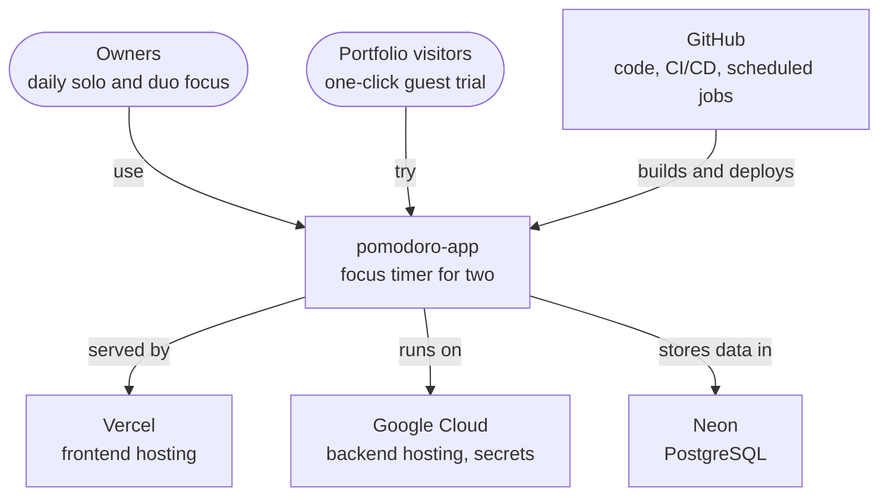

## 8. Architecture and deployment

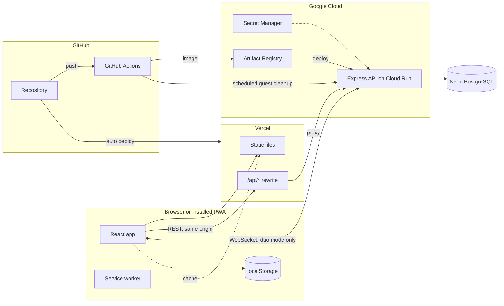

How it fits together:

- **Phases 1–2** use only the left side: the React app, the service worker,
  and localStorage, hosted on Vercel.
- **REST calls** go to `/api/*` on the same domain as the frontend. Vercel
  forwards them to Cloud Run. Because the browser sees one origin, the auth
  cookie is a first-party cookie and CORS is not needed.
- **WebSocket** connects straight to Cloud Run. Vercel's docs do not say that
  external rewrites proxy WebSocket upgrades, so we do not rely on it. Because
  the socket goes to a different domain, the auth cookie is not sent. Instead,
  the client first gets a short-lived ticket over REST, then opens the socket
  with it.
- **Guest cleanup** runs on a schedule and deletes expired guests.

## 9. Component design

### 9.1 Repository layout (from phase 3)

In phases 1–2 the frontend lives in `src/` at the repository root. In phase 3
the repository becomes an npm workspaces monorepo:

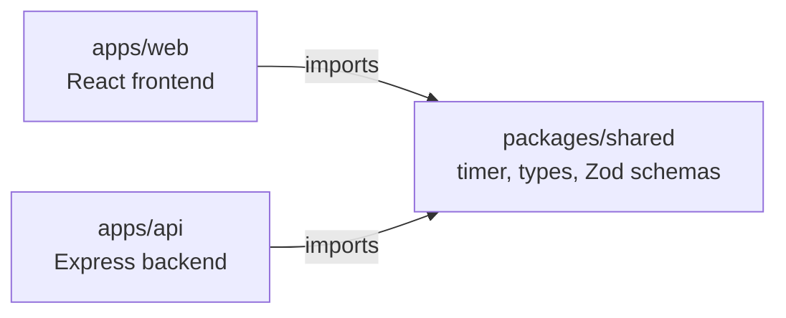

```text
pomodoro-app/
├── package.json              Workspaces and root scripts
├── tsconfig.base.json        Shared TypeScript settings
├── .oxlintrc.json            Shared lint rules
├── README.md
├── docs/design.md
├── .github/workflows/
│   ├── ci.yml                Lint, type check, test, build on every push
│   ├── deploy-api.yml        Build the image and deploy to Cloud Run
│   └── cleanup-guests.yml    Scheduled guest cleanup
├── packages/shared/src/
│   ├── timer.ts (+ test)     Pure timer logic, used by web and api
│   ├── format.ts (+ test)    Milliseconds to "mm:ss"
│   ├── schemas.ts            Zod schemas for API requests and responses
│   ├── types.ts              Shared types, including WebSocket messages
│   └── index.ts
├── apps/web/
│   ├── index.html
│   ├── vite.config.ts        Vite, Tailwind, PWA
│   ├── vercel.json           /api/* rewrite to Cloud Run
│   ├── public/               Icons, favicon, sounds
│   └── src/
│       ├── main.tsx, App.tsx, index.css
│       ├── pages/            TimerPage, LoginPage, SignupPage, StatsPage, RoomPage
│       ├── components/       TimerControls, TaskInput, SessionList, StatsChart,
│       │                     Navbar, LoadingScreen, GuestBanner
│       ├── scene/            PandaScene, Panda, sky.ts (+ test)
│       ├── hooks/            useTimer, useAuth, useSessions, useRoom
│       ├── api/              client.ts and one file per resource
│       └── storage/          localSessions.ts (phase 1 history)
└── apps/api/
    ├── Dockerfile
    ├── .env.example
    └── src/
        ├── server.ts         Start HTTP server, attach WebSocket server
        ├── app.ts            Build the Express app: middleware and routes
        ├── config/env.ts     Read and validate environment variables
        ├── db/               client.ts, schema.ts, migrations/
        ├── middleware/       requireAuth, validate, rateLimit, errorHandler
        ├── lib/              password.ts, tokens.ts
        ├── modules/          auth, sessions, stats, rooms, guests
        │                     (each: routes, controller, service, test)
        └── realtime/         wsServer.ts, roomHub.ts (+ test), messages.ts
```

### 9.2 Frontend component tree (phase 1)

Data flows down as props. Only `useTimer` owns the timer state, so the scene
and the numbers can never disagree.

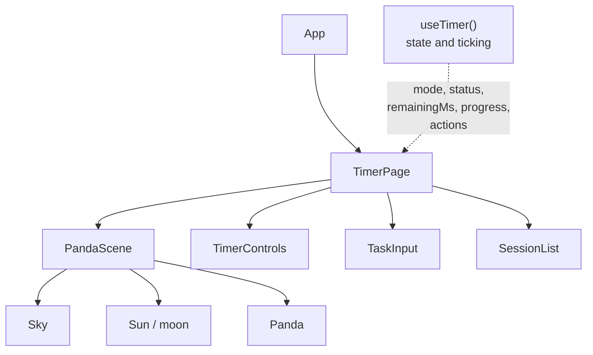

Frontend layers:

| Layer | Folder | Responsibility |
|---|---|---|
| Pages | `pages/` | One screen each. Compose components. |
| Components | `components/`, `scene/` | Show data and raise events. No data fetching. |
| Hooks | `hooks/` | State, effects, and calling the API layer. |
| API client | `api/` | The only place that calls `fetch`. Handles JSON and errors. |
| Shared logic | `packages/shared` | Pure functions and schemas used by both sides. |

### 9.3 Backend layers

Express does not enforce a structure, so the API uses a common layered
design. Each request passes through the layers in order:

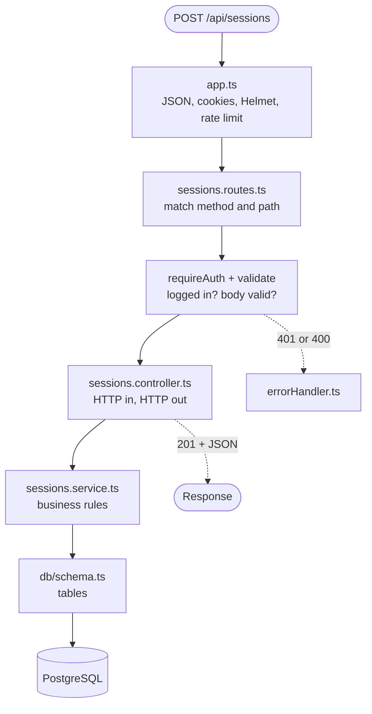

| Layer | Responsibility | Must not |
|---|---|---|
| `app.ts` | Cross-cutting middleware for every request | Know about individual features |
| Routes | Map method and path to a controller | Contain logic |
| Middleware | Authentication and validation | — |
| Controller | Read the request, call a service, write the response | Contain business rules or query the database |
| Service | Business rules, for example "guests cannot join real rooms" | Know about HTTP (`req`, `res`) |
| Schema / ORM | Table definitions and queries | — |
| Error handler | Turn any thrown error into a consistent JSON error | — |

Services have no HTTP code, so they can be unit tested directly and reused by
both the REST API and the WebSocket server.

## 10. Data model

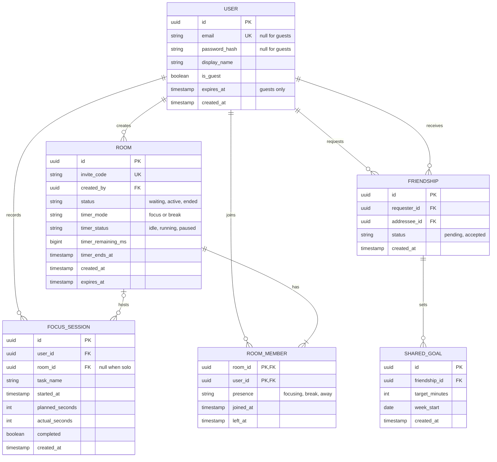

Notes:

- **Guests are regular users** with `is_guest = true` and an `expires_at`.
  Cleanup deletes expired guests, and their sessions, rooms, and memberships
  are deleted with them (`ON DELETE CASCADE`).
- **The room timer columns mirror `TimerState`** from `timer.ts`. The server
  stores the end timestamp, so a member who reconnects gets the correct
  remaining time, and the state survives an instance restart.
- **Phase 1 stores focus sessions in localStorage** with the same fields as
  `FOCUS_SESSION`, so moving them to the backend in phase 3 is simple.
- **Indexes:** `focus_session (user_id, started_at)` for history and stats,
  `user (expires_at)` for cleanup, unique `room (invite_code)`.
- **Times** are stored as `timestamptz` in UTC. The API sends timestamps as
  milliseconds since the Unix epoch, matching JavaScript's `Date.now()`.
- `FRIENDSHIP` and `SHARED_GOAL` are phase 6.

## 11. API

### Conventions

- All REST endpoints are under `/api` and use JSON.
- Request and response bodies are defined once as Zod schemas in
  `packages/shared`, and validated on both sides.
- Timestamps are milliseconds since the Unix epoch.
- Everything except sign-up, login, guest creation, and health requires a
  logged-in user.
- Errors always use the same shape:

```json
{ "error": { "code": "VALIDATION_FAILED", "message": "Task name is too long." } }
```

| Status | When |
|---|---|
| 200 / 201 | Success / created |
| 400 | Invalid request body or query |
| 401 | Not logged in |
| 403 | Logged in, but not allowed (for example, not a room member) |
| 404 | Not found, or not visible to this user |
| 409 | Conflict (for example, email already registered) |
| 429 | Rate limited |
| 500 | Unexpected server error. No internal details are returned. |

### Endpoints

| Method | Path | Purpose | Phase |
|---|---|---|---|
| POST | `/api/auth/signup` | Create an account | 3 |
| POST | `/api/auth/login` | Log in, set the auth cookie | 3 |
| POST | `/api/auth/logout` | Clear the auth cookie | 3 |
| GET | `/api/auth/me` | Current user | 3 |
| POST | `/api/auth/guest` | Create a guest account with demo data | 4 |
| GET | `/api/sessions` | List my focus sessions | 3 |
| POST | `/api/sessions` | Save a focus session | 3 |
| GET | `/api/stats?range=week` | My focus totals | 3 |
| POST | `/api/rooms` | Create a room, returns an invite code | 5 |
| POST | `/api/rooms/{code}/join` | Join a room | 5 |
| GET | `/api/rooms/{code}` | Room details and members (members only) | 5 |
| POST | `/api/rooms/{code}/ws-ticket` | Short-lived ticket to open the WebSocket | 5 |
| WS | `/ws/rooms/{code}?ticket=…` | Real-time timer sync | 5 |
| POST | `/api/internal/cleanup-guests` | Delete expired guests (scheduler only) | 4 |
| GET | `/api/health` | Health check | 3 |

### Example: save a focus session

Request:

```http
POST /api/sessions
Content-Type: application/json
Cookie: session=…

{
  "taskName": "Write README",
  "startedAt": 1795000000000,
  "plannedSeconds": 1500,
  "actualSeconds": 1500,
  "completed": true
}
```

Response `201 Created`:

```json
{
  "id": "6f1c…",
  "taskName": "Write README",
  "startedAt": 1795000000000,
  "plannedSeconds": 1500,
  "actualSeconds": 1500,
  "completed": true
}
```

### WebSocket messages

| Direction | Type | Payload |
|---|---|---|
| Client → server | `start`, `pause`, `reset`, `skip` | none |
| Client → server | `presence` | `focusing`, `break`, or `away` |
| Client → server | `ping` | none, keeps the connection alive |
| Server → client | `state` | Room timer state, member list, and `serverNow` |
| Server → client | `error` | `code` and `message` |

The server is the source of truth. Clients send intents, the server applies
them with the same pure timer functions from `packages/shared`, saves the
result, and broadcasts the new state to every member.

## 12. Key flows

### 12.1 Timer state machine

Two modes times three statuses. Every arrow is one pure function from
`timer.ts`. An action that does not apply (for example, pause while idle)
returns the same state.

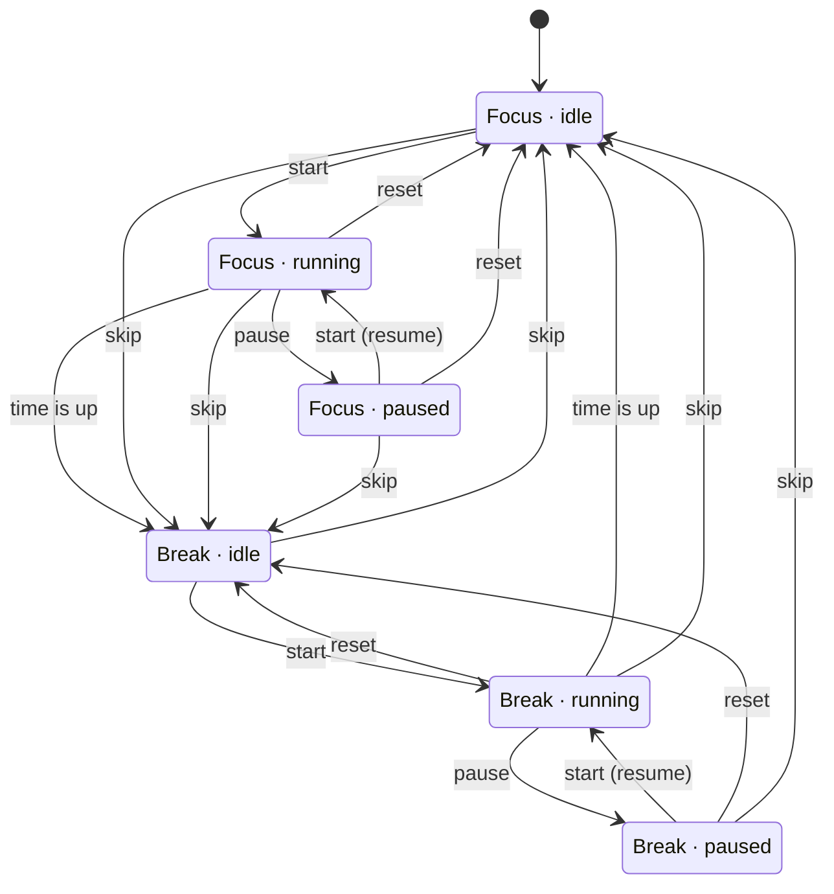

| State | Panda scene |
|---|---|
| Focus · idle | Morning, panda standing, cheeseburger on the grass |
| Focus · running | Sun sets as progress goes from 0 to 1; panda stands, sits, then lies down |
| Focus · paused | Scene frozen, paused indicator |
| Break · idle | Night, moon out, panda holding the cheeseburger |
| Break · running | Panda eats the burger, then sleeps hugging the wrapper; sky slowly brightens towards dawn |
| Break · paused | Scene frozen, panda keeps sleeping |

### 12.2 Sign-up and login

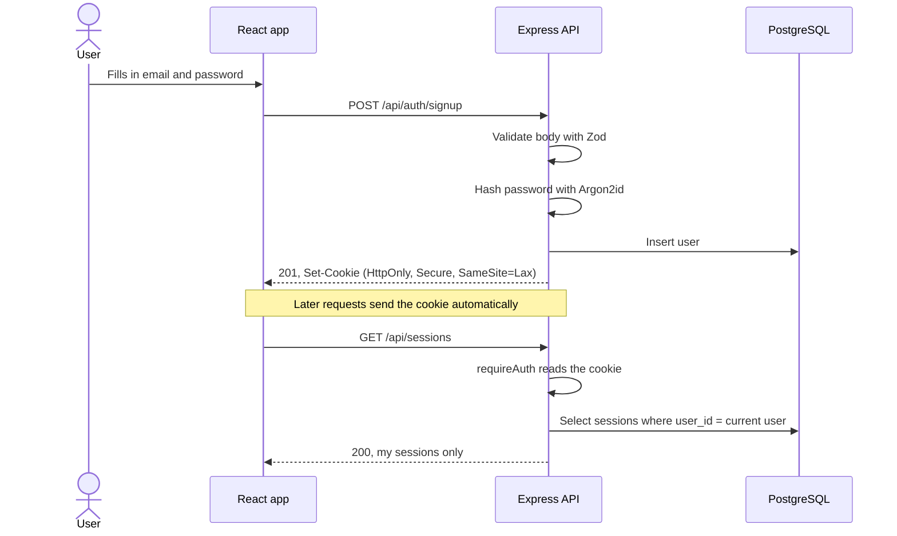

Login is the same, except the API looks up the user by email and verifies the
password hash. A wrong email and a wrong password return the same `401`
message, so the API does not reveal which emails are registered.

### 12.3 Guest trial and cleanup

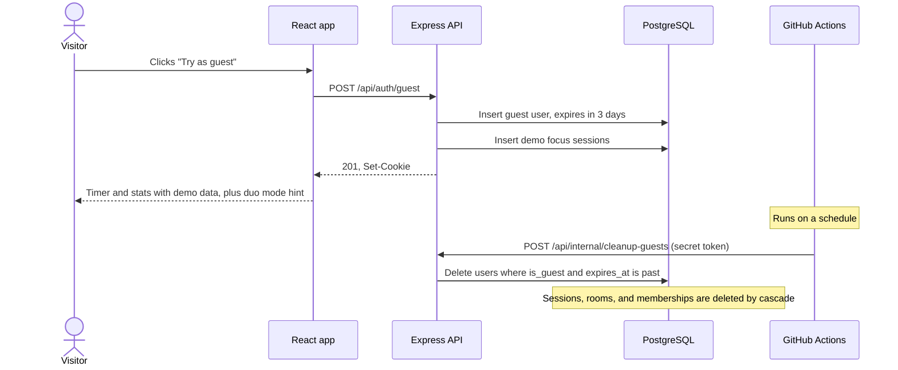

### 12.4 Duo mode

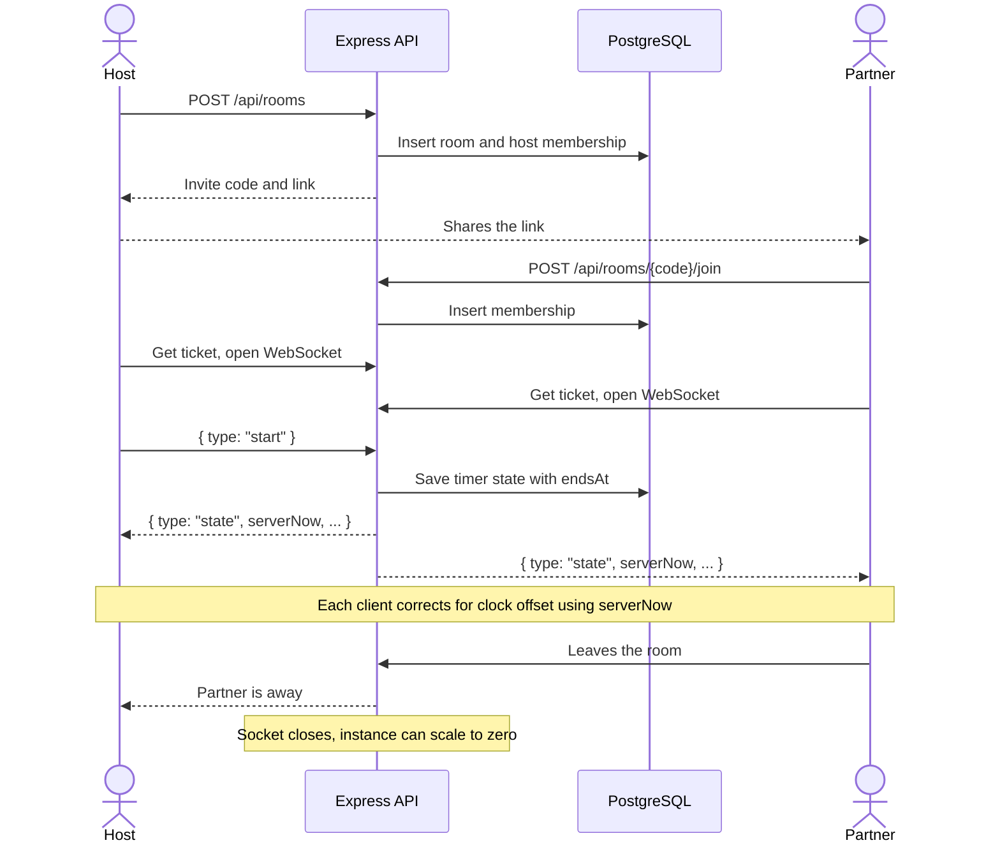

**Clock offset.** Two devices' clocks can differ by seconds. Each `state`
message includes `serverNow`. The client stores
`offset = serverNow - Date.now()` and uses `Date.now() + offset` as "now"
when computing the remaining time from `endsAt`. Both members then see the
same countdown, whatever their device clocks say.

---

# Part 3 — Keeping it safe, running, and cheap

## 13. Security

### Authentication

- Passwords are hashed with **Argon2id**. Plain passwords are never stored or logged.
- The session lives in a cookie with `HttpOnly` (JavaScript cannot read it),
  `Secure` (HTTPS only), and `SameSite=Lax`.
- Login errors do not reveal whether an email is registered.
- Token format, a signed stateless token or a server-side session table, is
  decided in phase 3 (see [open decisions](#19-open-decisions-and-risks)).

### Authorization

- Every query that reads or writes user data filters by the logged-in user's id.
  Ids in the URL are never trusted on their own.
- A record that exists but belongs to someone else returns `404`, not `403`,
  so other users' ids cannot be discovered.
- Room endpoints and WebSocket messages check room membership.
- Guests cannot create rooms with, or join rooms of, real accounts (FR-23).

### Input validation

- Every request body, query string, and WebSocket message is validated with Zod.
- JSON bodies are limited to 10 KB.
- Task names are limited to 100 characters.

### Rate limiting **(proposed values)**

| Endpoint | Limit per IP |
|---|---|
| `POST /api/auth/login` | 5 per minute |
| `POST /api/auth/signup` | 3 per hour |
| `POST /api/auth/guest` | 5 per hour |
| Everything else | 100 per minute |

`express-rate-limit` keeps counters in memory, which works because there is one
backend instance. The real client IP must be read from the forwarding headers
set by Vercel and Cloud Run; how those headers arrive is verified in phase 4.

### WebSocket

- The socket connects only with a **ticket**: random, single use, valid for
  60 seconds, and tied to one user and one room.
- The server checks the `Origin` header against the frontend's domain.
- Each connection is limited in message size and rate.

### Browser security

- React escapes text by default. `dangerouslySetInnerHTML` is not used.
- Helmet sets secure HTTP headers on the API.
- CSRF: the cookie is `SameSite=Lax`, the API is same-origin through the
  Vercel rewrite, and state-changing requests check the `Origin` header.

### Secrets

- Local development uses an `.env` file that is git-ignored. `.env.example`
  lists every variable without real values.
- In production, secrets live in Secret Manager and are injected into Cloud
  Run as environment variables.
- GitHub Actions deploys with Workload Identity Federation **(proposed)**, so
  no long-lived Google Cloud key is stored in GitHub.
- The internal cleanup endpoint requires a secret token stored in GitHub
  Actions secrets.

### Dependencies

- Dependabot alerts are on for the public repository.
- CI runs `npm audit` and fails on high-severity issues **(proposed)**.

## 14. Reliability and failure modes

| What can fail | What the user sees | How we handle it |
|---|---|---|
| Cloud Run cold start | First API call takes a few seconds | `LoadingScreen` while waiting. The solo timer never waits for the API. |
| Neon database suspended after 5 minutes idle | First query is slower | Connection timeout and one retry |
| User goes offline | Solo timer keeps working | PWA cache. Unsaved sessions are kept in localStorage and sent when back online **(proposed)**. |
| WebSocket drops, including Cloud Run's maximum request timeout of 60 minutes | Brief "Reconnecting…" | Automatic reconnect with backoff. Room state is read back from the database. |
| Backend instance restarts | Brief reconnect | Room state lives in the database, so nothing is lost |
| Device clocks differ | Nothing | Clock offset correction with `serverNow` |
| A free tier is used up | Vercel pauses the project; Neon suspends compute until next month | Budget alerts and the usage numbers in [Cost](#17-cost) |
| A bad deploy | Errors after a release | Roll back to the previous Cloud Run revision or Vercel deployment |
| Data is deleted by mistake | — | Neon's restore window on the free plan (about 6 hours of history) |

The React app has an error boundary, so a bug in one component shows a
friendly message instead of a blank page.

## 15. Observability

| What | How |
|---|---|
| API logs | Structured JSON logs (pino) to stdout, collected by Cloud Logging. Each request has a request id. Passwords, cookies, and tokens are never logged. |
| Health | `GET /api/health` returns 200 and checks the database connection. |
| Metrics | Cloud Run's built-in metrics: request count, latency, errors, instance count. |
| Frontend errors | Error boundary in React. Sentry in phase 6. |
| Costs | Billing reports and budget alerts on Google Cloud. Usage pages on Vercel and Neon. |

## 16. Environments and CI/CD

### Environments

| Environment | Frontend | Backend | Database |
|---|---|---|---|
| Local | `npm run dev` | `npm run dev` in `apps/api` | Neon development branch, or local PostgreSQL |
| Preview | Vercel preview deployment for each pull request | — | — |
| Production | Vercel, from `main` | Cloud Run, from `main` | Neon main branch |

### Pipeline

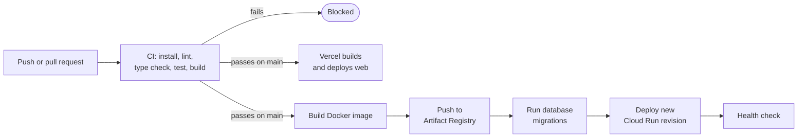

Scheduled workflow: `cleanup-guests.yml` calls the internal cleanup endpoint
on a schedule **(proposed: daily)**.

## 17. Cost

Free tier numbers come from the providers' official pages (see
[References](#21-references)). They change over time, so check them again
before deploying.

| Service | Free tier (as of 2026-11) | Our estimate | Risk |
|---|---|---|---|
| Vercel Hobby | About 100 GB fast data transfer per month; personal, non-commercial use only; the project is paused, not billed, if it goes over | About 100 MB | Very low |
| Cloud Run (request-based billing) | 2 million requests, 180,000 vCPU-seconds, 360,000 GiB-seconds per month, per billing account | 150,000 requests; about 216,000 instance-seconds from duo mode | **Medium**, see below |
| Neon Free | 100 CU-hours of compute and 1 GB storage per project; scales to zero after 5 minutes | About 25 CU-hours; under 10 MB | Low |
| Artifact Registry | 0.5 GB storage per month | One or two images of about 100–200 MB | Low, if old images are deleted |
| Secret Manager | 6 active secret versions, 10,000 access operations per month | 3–4 secrets | Low |
| GitHub Actions | Free for public repositories on standard runners | — | Very low |

**The duo mode risk.** An open WebSocket keeps the Cloud Run instance busy,
so 2 hours a day is about 216,000 instance-seconds a month:

- At **1 vCPU**, that is 216,000 vCPU-seconds, **over** the 180,000 free.
- At **0.5 vCPU**, it is 108,000 vCPU-seconds, within the free tier.
- At 512 MiB memory, it is 108,000 GiB-seconds, within the 360,000 free.

So the API runs with a small CPU setting **(proposed: 0.5 vCPU or less, 512
MiB)**, and the exact allowed values are checked in Cloud Run's docs in
phase 4.

**Guard rails:**

- A Google Cloud budget of $1 with alerts at 50%, 90%, and 100%.
- Cloud Run maximum instances capped (see open decisions).
- An Artifact Registry cleanup policy that keeps only the latest few images.

---

# Part 4 — Decisions and plan

## 18. Key design decisions

| Decision | Why |
|---|---|
| Timer stores an end timestamp, not a per-second countdown | Browsers throttle timers in background tabs. Computing `endsAt - now` stays accurate. |
| Timer logic is pure functions with `now` passed in | Easy to unit test without waiting or faking clocks. The same logic drives the UI and the server. |
| When time is up, the next mode waits for the user | The user may be away; a break should not run out unseen. A sound tells them time is up. |
| TypeScript on both frontend and backend (Node.js + Express) | One language end to end. The frontend and backend share types, Zod schemas, and `timer.ts`, so both sides compute the timer the same way. Express is the most common Node.js framework in job postings. |
| Monorepo with npm workspaces | Shared code without publishing packages. One pull request can change frontend, backend, and shared code together. |
| Layered backend: routes, controllers, services | Services have no HTTP code, so they are easy to test and reused by REST and WebSocket. |
| Scene is driven by `progress` (0 to 1) and `status` only | The animation has no state of its own, so it can never drift from the timer. |
| Panda poses are discrete (stand, sit, lie, eat, sleep) with smooth transitions | Continuous shape morphing is much harder and often looks odd. The sky and sun change continuously. |
| WebSocket only in duo mode | Keeps Cloud Run idle, and free, the rest of the time. |
| REST goes through a Vercel rewrite | Same-origin requests keep the auth cookie first-party, which avoids third-party cookie blocking in Safari and removes the need for CORS. |
| WebSocket uses short-lived tickets | The socket goes straight to Cloud Run, a different domain, so the cookie is not sent. A ticket proves who the user is without exposing the session. |
| Room timer state lives in the database | A reconnecting member gets the right time, and nothing is lost when the instance restarts. |
| Server sends `serverNow` with every state | Corrects for different device clocks, so both members see the same countdown. |
| Guests are normal users with an expiry | One code path for both, and cleanup is a single delete. |

## 19. Open decisions and risks

### Open decisions

| Topic | Options | Leaning | Decide in |
|---|---|---|---|
| ORM and migrations | Prisma or Drizzle | — | Phase 3 |
| Auth token | Signed stateless token in an `HttpOnly` cookie, or a server-side session table | — | Phase 3 |
| Page routing | React Router or a simpler hand-written router | React Router | Phase 3 |
| Cloud Run max instances | 1, or 2 with cross-instance broadcast | **1**: enough for the estimated load, and both duo members always reach the same instance, so in-memory broadcast works | Phase 4 |
| Cloud Run CPU and memory | Smallest settings that fit the free tier | 0.5 vCPU or less, 512 MiB | Phase 4 |
| Guest cleanup trigger | GitHub Actions schedule or Google Cloud Scheduler | GitHub Actions (no extra Google Cloud setup) | Phase 4 |
| Offline session sync | Queue in localStorage and retry, or skip offline saves | Queue and retry | Phase 3 |

### Risks

| Risk | Impact | Mitigation |
|---|---|---|
| Duo mode CPU time exceeds the Cloud Run free tier | Small monthly cost | Small CPU setting, budget alerts |
| Max instances 1 becomes a bottleneck | Slow responses under a traffic spike | The estimated load is far below one instance's capacity. If needed, raise it and add cross-instance broadcast (for example PostgreSQL `LISTEN/NOTIFY`, after checking Neon's support). |
| Cold starts make the first visit feel slow | Visitors may leave | Loading screen; the solo timer works without the API |
| Real client IP is hidden behind two proxies | Rate limiting applies to the proxy instead of the user | Verify forwarding headers in phase 4 before enabling rate limits |
| Free tier terms change | Unexpected limits or costs | Re-check official pages before each deploy phase; budget alerts |
| Schedule slips | Phases 4–5 late | Cut guest-trial polish or duo presence animations first |

## 20. Delivery plan

| Phase | Scope | Target |
|---|---|---|
| 1 | Solo timer, panda scene, sound, task names, localStorage, deploy to Vercel | 2026-11-27 |
| 2 | PWA: install, offline, notifications | 2026-11-28 |
| 3 | Monorepo, Express API, PostgreSQL, accounts, stats | 2026-12-01 |
| 4 | Docker, Cloud Run, CI/CD, guest trial, rate limiting | 2026-12-03 |
| 5 | Duo mode with WebSocket | 2026-12-05 |
| 6 | Friends, shared goals, Playwright, Terraform, Sentry | After 2026-12-05 |

## 21. References

- [Cloud Run pricing](https://cloud.google.com/run/pricing)
- [Cloud Run: using WebSockets](https://docs.cloud.google.com/run/docs/triggering/websockets)
- [Cloud Run: session affinity](https://docs.cloud.google.com/run/docs/configuring/session-affinity)
- [Neon plans](https://neon.com/docs/introduction/plans)
- [Neon Free plan limits](https://neon.com/faqs/free-plan-limits-and-quotas)
- [Vercel Hobby plan](https://vercel.com/docs/plans/hobby)
- [Vercel fair use guidelines](https://vercel.com/docs/limits/fair-use-guidelines)
- [Vercel rewrites](https://vercel.com/docs/rewrites)
- [Artifact Registry pricing](https://cloud.google.com/artifact-registry/pricing)
- [Secret Manager pricing](https://cloud.google.com/secret-manager/pricing)
